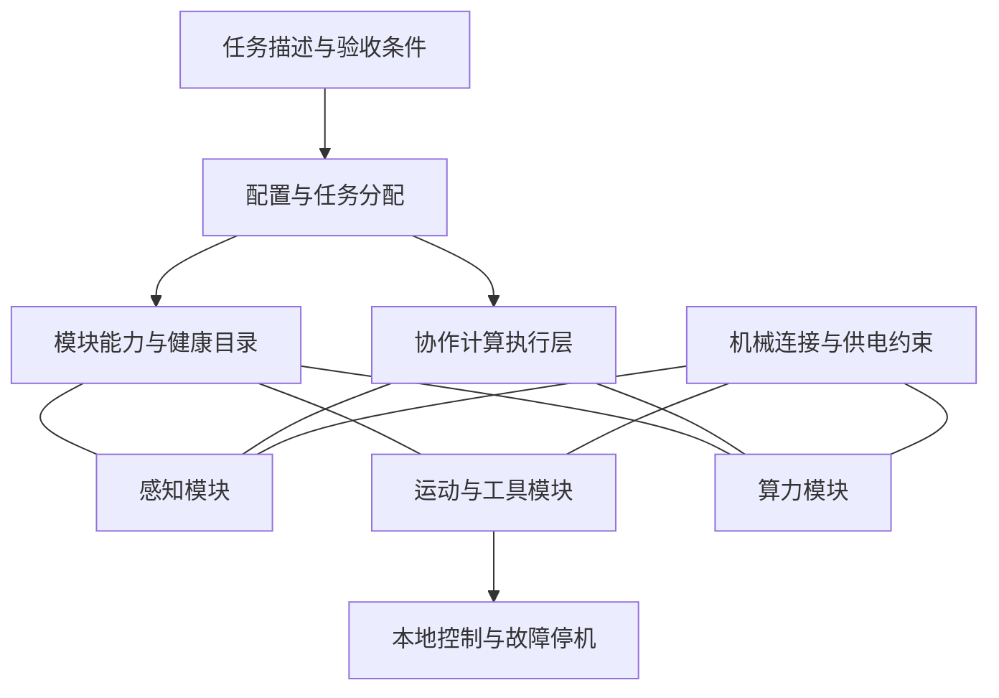

# 架构草案 RFC-0001

状态：讨论稿。原有功能模型已经实现；v0.2 新增 [跨任务规划](portfolio.md) 和 [本机多进程实验](runtime.md)。它们是有限的软件基线，后文面向真实模块的协议、控制和硬件部分仍为提案。

## 分层与责任

系统需要同时解决机械、电源、数据、语义和任务五种兼容性。数据包可以互通，不等于承重、电压、时序和能力语义兼容。

## 当前功能模型

`examples/catalog.json` 提供库存与功能任务。模块字段如下，能力名称为示例自定义词汇，未声明符合外部标准。

| 字段 | 含义与当前检查 |
| --- | --- |
| `id` | 实例唯一、非空字符串 |
| `type` | 型号分类标签，非空字符串；不自动验证同型号物理一致性 |
| `capabilities` | 非空能力字符串列表；同一模块内重复能力只计一次 |
| `interface` | 非空接口标签，任务要求与模块标签必须相等；不是实物接口认证 |
| `power_w` | 假设的工作功耗，有限且非负；不是实测或峰值电流 |
| `status` | `ready`、`fault` 或 `offline` |

任务包含 `id`、`need`（能力及所需实例数量）、`interface` 和 `power_budget_w`。单实例可以提供多个不同能力，不建模它们是否能够同时运行；真实任务需增加资源冲突约束。示例任务逐个规划，不模拟同时抢占库存。

`validate_catalog` 返回标准化输入，`choose_modules` 接收该标准化结果。选择器在最多 20 个输入模块内枚举，按“型号数、实例数、功耗、ID”字典序选择。功耗、接口和能力计数为硬约束。无可行方案时显式返回 `feasible: false`。

v0.2 的 `choose_portfolio` 进一步在最多 16 个模块、32 项顺序任务中选共享库存，并检查同型号声明规格一致。它复用符号任务约束，仍不验证实物兼容性。

供电来源、结构件、连接器和固定件在当前模型之外。不能把示例里四个实例和三个类型当成完整机器人 BOM，或据此宣布“三种零件足够”。

## 候选模块族，待实验压缩

| 候选族 | 功能 | 需验证的问题 |
| --- | --- | --- |
| 结构与连接 | 承重、固定、对接、姿态关系 | 连接寿命、重复定位、抗振、释放能力 |
| 电源 | 供电、保护、隔离、计量 | 峰值电流、接入次序、故障传播 |
| 感知 | 摄像、距离、力等观测 | 校准、时钟、坐标系、数据质量 |
| 运动 | 关节、线性或轮式驱动 | 扭矩、速度、负载、失电行为 |
| 工具 | 夹持与任务末端功能 | 接触材料、夹持范围、装配约束 |
| 算力 | 推理、规划、模型缓存 | 内存、算子支持、散热与工作负载效率 |

这是便于讨论的功能划分，不是已确定的六种产品。某些功能可以合并，某些必须分开；结构件也未必需要高算力处理器。应让任务与成本数据决定边界。

## 模块描述的下一版

后续格式应在当前字段之外定义版本、固件与模型摘要、坐标系与单位、连接面与方向、尺寸质量、扭矩和速度限值、持续/峰值电流、温度、计算后端/精度/可用内存、测量条件和校准状态。吞吐或功耗数据必须伴随测量日期、方法和负载；不能只报 TOPS。

兼容性检查按机械、电气、数据版本、能力语义和任务约束分别返回原因。优先对照 [HRIM 与 ROS 2 的已有工作](references.md)，不另造一套消息传输层来证明创新。

## 去中心化的明确含义

目标是组件能相互发现、交换能力和健康信息，并在任务节点故障后重新分配可迁移工作。不要求所有决策都“无中心”，任务可以有临时协调者；本地电机闭环与失效停机应由相应模块负责。

拟分开三类流量：本地控制、任务调度、可延迟的大计算。大计算拥塞不应拖住本地控制。ROS 2 的发现机制可作为候选基础设施，但本项目尚未接入 ROS 2；发现成功也不等于任务唯一分配或硬实时成立。

协议提案至少需要以下语义，目前尚未实现或证明：

| 消息 | 必要内容 | 失败时的处理原则 |
| --- | --- | --- |
| `ANNOUNCE` | 节点ID、启动会话、描述版本、能力摘要 | 版本不匹配或未授权节点不参与任务 |
| `HEARTBEAT` | 启动会话、序号、健康、当前任务 | 超时标记不可用，不把一次丢包直接当物理损坏 |
| `OFFER` / `ASSIGN` | 任务ID、配置摘要、资源需求、截止时间、租约 | 无法满足约束则拒绝；状态不明时避免重复物理动作 |
| `ACK` / `RESULT` | 任务ID、尝试ID、模型与输入摘要、结果质量 | 去重、超时及过期结果拒收 |
| `FAULT` / `REJOIN` | 故障原因、校准状态、新启动会话 | 隔离后复验；重新出现不代表可直接复工 |

租约加 fencing token（旧持有者失效后拒绝其命令的递增凭据）是候选设计。网络分区时，单凭心跳无法区分断网和宕机；不能让两个协调者同时控制同一执行器。如何可靠分配 token、恢复状态以及管理信任边界仍是独立待解问题，不宣称本草案已经解决一致性。

纯计算任务可在可重复、无外部副作用的条件下重试；抓取、放下、移动等物理动作不可直接照搬重试策略，必须结合观测重新确认状态。热插拔也不是模块化的自动属性，第一轮硬件实验采用停机、断电、换件、复验的流程。

## 计算策略候选

先测试整任务分配，再测试流水线或模型切分，最后考虑更高同步频率的并行策略。根据截止时间、数据大小、内存和链路测量决定是否卸载；无法满足时回退到已验证的本地模式或报告任务不可执行。

v0.2 已有固定绑定本机的 HTTP 工作进程实验，使用单协调器进行分配与故障回收。它不是上表协议的完整实现，也没有跨设备运行、动态模型迁移、真实自动组装或去中心化调度。具体已实现的行为与缺口以 [运行指南](runtime.md) 为准。
