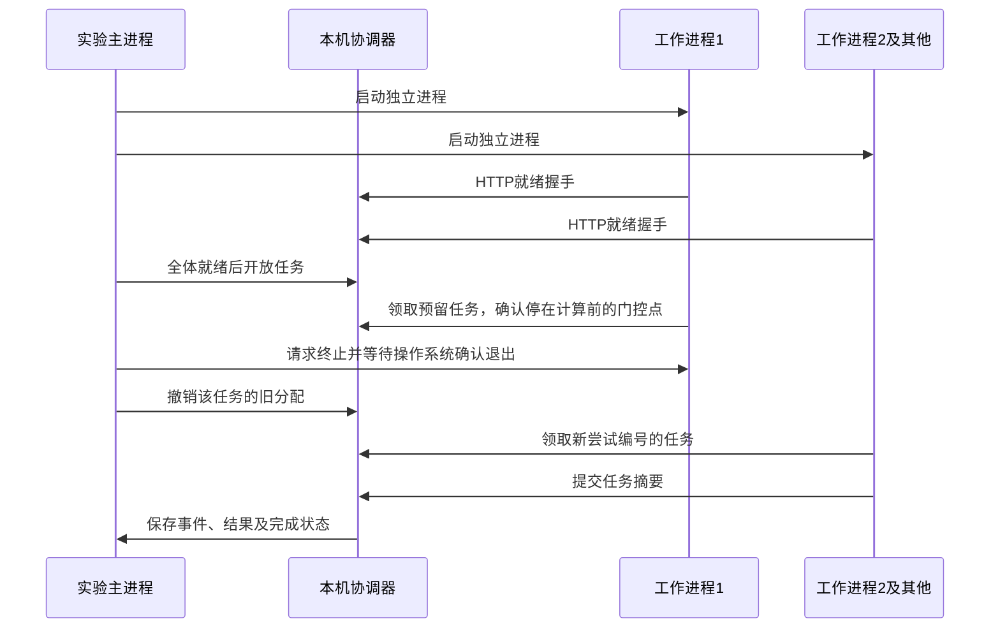

# 本机多进程协作与故障恢复

状态：v0.2.0 实验基线。它用真实子进程和本机 HTTP 请求执行合成计算；采用一个中央协调器，不是去中心化运行时，也不是机器人控制软件。

## 一条命令

```sh
python -m prime_components runtime --workers 3 --tasks 12 --iterations 20000 --timeout 30 --output results/runtime.json
```

命令依次运行单工作进程、多个正常工作进程、多个工作进程中一个故障三种场景，并将报告保存为 JSON。`workers` 是后两种场景的初始工作进程数；故障场景保留原有其余工作进程接管任务。所有场景的输入完全相同。

任务输入来自固定 ID 生成的摘要，每项执行指定次数的 SHA-256 链计算。它有实际 CPU 工作量，不包含用来伪造吞吐的任务睡眠。协议轮询中的短等待和启动、连接、序列化开销仍会影响测时。

本机多个进程共享同一 CPU、内存与操作系统。任务很小时，启动和通信可能占主导；即使观测到加速，也不能据此推导多台开发板、神经网络推理或数据中心性能。

## 实际发生什么



故障注入刻意发生在任务已领取、计算尚未开始的位置。这使测试可重复，证明的是进程退出后的未完成任务恢复，不代表任意计算时刻中断都已测试，也不是检查点续算。重派会从头计算。

## 结果如何判断

每个结果必须与协调器事先计算的串行参考值一致；多工作进程场景还与单工作进程场景逐项比较。报告保留各任务摘要，不能仅凭 `all_correct` 一个布尔值代替结果检查。

分配包含工作会话、任务尝试编号和本次分配凭据。协调器在锁内检查结果是否属于当前持有者；旧分配、错误持有者、重复提交或不匹配的摘要不会成为有效完成结果。这里保证的是这一协调器生命周期内每任务至多接受一个结果，工作可能重新执行，不能称为“计算恰好执行一次”。

目前回收依据是实验主进程确认子进程退出。没有通过超时租约检测仍存活但卡死的工作进程，也没有证明网络分区下的行为；总实验截止时间负责让未完成实验有界结束。

## 测时与事件

报告区分启动至全部结果接受的场景耗时 `wall_s`、首次分配至完成的耗时 `dispatch_to_complete_s`、故障注入至首个重试任务成功和全部任务完成的间隔。故障起点为发出终止请求之前；确认退出和分配回收另外记录。

事件使用协调器的同一单调时钟，包含相对时间、顺序号、任务 ID、尝试编号以及不含凭据的工作进程标签。`workers_started` 与 `workers_hello_ready` 记录启动和握手数量；`workers_claimed` 是领取过任务的进程标签，`workers_completed` 则只包含至少有一个结果被接受的进程。故障进程可能领取过任务但没有完成计算，任务数量较少时也可能有正常进程未领取任务。

这些时间包含本机调度、Python 和 HTTP 开销；串行校验器准备时间单独记录。正常完成的场景耗时止于全部任务结果被接受，不含之后清理时间；失败场景的口径见 JSON 字段说明。它们不是实物维修时间或工业 MTTR。

## 参数与失败报告

当前限制最多 16 个工作进程、100 项任务，每项最多 100000 次迭代，总迭代数不超过 500000。默认包含故障场景，因此工作进程至少为 2；单进程基线会自动运行。HTTP 消息体限制为 16 KiB。

`--timeout` 是三种运行场景共享的截止时间，包含工作进程启动。有限规模的串行参考值准备和必要的进程清理不算在该运行截止时间内，所以命令实际耗时可能稍长。默认 30 秒，最大 300 秒。

退出码 0 表示全部场景完成且匹配参考结果；1 表示有界实验未完成，仍保存报告；2 表示非法参数或报告读写失败。请保留失败报告，不能只汇总成功运行。独立的测试入口还覆盖所有工作进程退出和极短截止时间，不用无限重试掩盖无可用进程。

## 协议与部署边界

工作进程只接受规定的摘要计算描述，不加载用户代码，不传输 Python pickle，不执行 shell。服务器固定绑定 `127.0.0.1` 的临时端口，并使用短期实验凭据；客户端禁用代理，凭据不写入报告。

HTTP 路径服务于这个实验，不是稳定的对外 API。Python 官方说明 [`http.server`](https://docs.python.org/3.10/library/http.server.html) 不适用于生产服务；这里只用于本机实验。工作进程由 [`subprocess`](https://docs.python.org/3.10/library/subprocess.html) 启动并由实验负责回收。

尚无跨设备寻址、TLS、可信身份、持久化日志、协调器恢复、负载感知调度、神经网络模型切分或执行器控制。要比较去中心化方案，下一步应在相同任务与故障模型上实现另一种协调策略，保留这套中央基线作为对照。

## 重跑公开记录

```sh
python scripts/record_local_evidence.py --output results/local-evidence
```

脚本运行测试、三次完整实验、一次所有工作进程退出的负例和库存规划示例，保存原始 JSON、测试输出与源文件摘要。三次实验固定顺序，只用于重复检查软件行为；样本少且未随机化，不能作为性能显著性结论。
